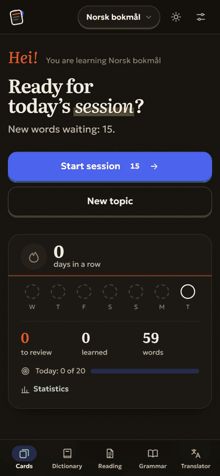
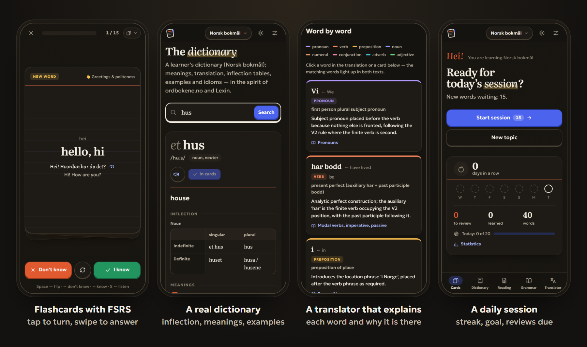

<div align="center">

<a href="https://ordkort.com"></a>

# Ordkort

**Flashcards, a real dictionary and grammar for 60 languages.**<br>
Free · no sign-up · no ads · no tracking · works offline

[**Open ordkort.com →**](https://ordkort.com) &nbsp;·&nbsp; [About](https://ordkort.com/en/) &nbsp;·&nbsp; [Contributing](CONTRIBUTING.md) &nbsp;·&nbsp; [Report a problem](https://github.com/silicq/ordkort/issues/new/choose)

[](https://github.com/silicq/ordkort/actions/workflows/test.yml)
[](LICENSE)
[](https://ordkort.com)



</div>

## Why

Anki is powerful but starts empty, and you build every deck yourself. Most other apps want an account, a
subscription or your data. Ordkort gives you **ready word lists for 29 topics and levels A1–C1** with the same
**FSRS** scheduler that Anki offers, plus a dictionary, a grammar book and a translator that explains every
word. AI writes the cards, and they are **checked against real dictionaries**: the official Norwegian
dictionaries at ordbokene.no, and Wiktionary for other languages. Everything stays in your browser; devices
sync without an account, end-to-end encrypted.

<p align="center"></p>

## Features

Ordkort is a lightweight site for learning almost any language from almost any other one:

- **Flashcards** by topic with spaced repetition (FSRS-4.5) — “I know / I don’t know” for new words,
  “I remember / I forgot” for reviews. Tap to flip, swipe, keyboard shortcuts, text-to-speech.
  Five more study modes: multiple choice, typing (with an on-screen row of special letters;
  one typo or pinyin/romaji for a non-Latin script still count, the right word in another form
  is half-right: not a mistake, but the card comes back), listening, fill-the-gap in the example
  sentence, or a mix. Pinyin, romaji and other romanizations stay off the front of a card (one tap shows
  them), so the characters themselves are read. Each language has its own limit of new words a day, and
  the language switcher shows how many reviews wait in each.
- **Topics**: 29 built-in topics in 6 groups (first steps, people, everyday life, the world around,
  work & society, grammar sets), any custom topic, or an empty deck for your own words.
  AI picks real, frequent words for levels A1–C1; “+20 words” keeps extending a deck without repeats.
- **Dictionary** in the spirit of [ordbokene.no](https://ordbokene.no) and
  [Lexin](https://lexin.oslomet.no): translation, inflection tables, meanings with examples,
  fixed expressions, compounds. For Norwegian, the official Bokmål/Nynorsk dictionary data is shown
  alongside and used as ground truth for the AI entry, and every AI-written noun and verb card is checked
  against it once: a wrong article or wrong forms are fixed (in the shared word bank for everyone, and in
  cards saved earlier by a background check in the browser). For other languages the server checks nouns
  and verbs against [Wiktionary](https://en.wiktionary.org) the same way: the article must fit the noun's
  gender ("die Hund" → "der Hund"), a gender is confirmed where the word does not show it ("книга"), and
  forms Wiktionary has never heard of are dropped. The dictionary page for these languages shows the
  Wiktionary entry next to the AI one (gender, key forms, pronunciation, senses with short examples, origin;
  explanations in English), uses it as ground truth for the AI entry, and links to the main dictionaries of
  the language (RAE, Duden, Larousse, Treccani, Jisho…). Translations still come from the AI alone.
- **Grammar book**: 15 chapters by part of speech (nouns, adjectives, verbs, word order…) with tables,
  examples, typical mistakes and exercises, plus free-form grammar questions.
- **Translator with explanations**: every word colour-coded by part of speech, with its form and the rule
  that explains why it is used exactly there.
- **Reading**: paste any text; words are coloured as new / learning / known, tap one to see its
  meaning in that context and add it to your cards.
- **Statistics and a daily goal**: streak, reviews over 30 days, a 14-day forecast, words by stage,
  the words you forget most.
- **Your own words in and out**: CSV export and import (including Anki “Notes in plain text”),
  and sharing a deck by link or QR code — only the words, never your progress.
- **Works offline**: a service worker keeps the site, so cards open without a connection.
  After a deploy the app notices the new version by itself — also when it is installed on a phone
  and only woken up — and loads it at the next move to another screen.
- **Report a mistake** on any AI entry; after independent reports it is regenerated for everyone.
- **60 languages** to learn and explain in. The interface is hand-translated into English, Russian,
  Ukrainian, Norwegian, Arabic (RTL) and Chinese; other interface languages are translated once by AI
  and shared.

## Architecture

```
public/            the site: HTML, CSS, JS, fonts — served by Cloudflare as static assets
  _headers         security headers (CSP etc.)
  sw.js            service worker for offline use
  js/build.js      the version of the site, written at every deploy (not in git)
  js/bundle.js     all the scripts of the app in one minified file, written at every deploy (not in git)
src/               Cloudflare Worker — runs only for /api/*
  worker.js        routing and same-origin check
  api.js           AI requests: shared cache → word bank → limits → Groq
  prompts.js       all prompts and validation of AI output
  facts.js         verified Norwegian Bokmål grammar facts used to ground the AI
  wiktionary.js    Wiktionary for other languages: checks cards, and the entry shown in the dictionary
  groq.js          Groq client with model fallback
  limits.js        burst, hourly, daily and site-wide limits
  warm.js          a base of ready decks: every 15 minutes, while the site is quiet, the cron fills one more
                   group of the shared word bank, from the decks used most to the rarer ones
  sync.js          device sync and one-time codes (the server only ever sees ciphertext)
  db.js            D1: the schema is created automatically on the first request
scripts/build.mjs  writes public/js/bundle.js (the scripts listed in scripts/bundle.mjs, minified by esbuild)
                   and public/js/build.js; wrangler runs it before every deploy and `wrangler dev`
scripts/landing.mjs  plain pages about the site for search engines (public/<lang>/, 6 languages)
scripts/seo-pages.mjs  static Norwegian pages for search engines, in English, Russian, Ukrainian and Norwegian:
                   29 topic word lists (/<ui>/<learn>/<topic>/), ~530 dictionary entries (/<ui>/ordbok/nb/<word>/),
                   two hubs and a page for teachers per language (texts in scripts/teachers-text.mjs),
                   the pages above and sitemap.xml. Content in data/seo/ (see its README);
                   run `npm run seo` after changing it (a test checks the files are up to date)
data/seo/          the words, translations and examples of those pages, official forms from Bokmålsordboka
tests/             node:test suites (see below)
wrangler.jsonc     Cloudflare configuration
```

**User data** — cards, progress, settings — lives in the browser’s localStorage; the history of every answer
(what “What goes wrong” reads) and pictures for cards live in its IndexedDB, on that device only, never synced. Only AI requests
(a word, a topic or a text plus the language pair) reach the server, plus decks you choose to share
by link (kept for a year) and anonymous mistake reports (kept for 30 days). Answers are stored in a shared
base, so the next person gets them instantly and without using their limit.

**The Groq key** lives only in the Worker secret. The browser sends parameters, not prompts,
so the API can’t be used as someone else’s free chatbot.

**Limits** (change them in `wrangler.jsonc` → `vars` or in the Cloudflare dashboard):
`AI_PER_HOUR` = 40 and `AI_PER_DAY` = 120 per person, `AI_DAILY_BUDGET` = 2500 for the whole site.
A person is identified by a hash of the IP address with a salt that changes every day;
the IP itself is never stored.

**What the AI can carry.** Groq's free plan gives each of the three models 200,000 tokens in any 24 hours.
A list of words takes 5,000–7,000 tokens, a dictionary entry or a translation a few thousand, so the whole site
gets about 100–150 new AI answers a day; everything already generated (the shared cache and word bank) costs
nothing. That is why the bank of ready decks matters: the cron fills it slowly (`WARM_PER_DAY`, 24 lists a day,
about a fifth of the capacity), and `npm run warm` stops after 25 lists. A paid Groq plan lifts the limit.

**Sync without accounts.** A random 32-byte secret exists only on the user’s devices. It derives the
copy’s id, a write token and an AES-256-GCM key. The server stores ciphertext and a hash of the token.
Devices are linked with a one-time 16-character code (valid for 3 minutes, burnt on first read) or a QR
link whose key part sits after `#` and is never sent to the server. A one-time transfer without cloud
storage is also available. A 54-character **recovery key** restores the encrypted copy if the browser
data is wiped on every device.

Users can read all of this in plain words on the site’s “How it works” page (`#/about`).

## Keeping data safe

- Clearing the browser **cache** does not touch the cards; clearing **site data / cookies** does.
- Safari on iPhone and iPad deletes the data of sites not opened for 7 days — unless the site is
  added to the Home Screen. The site is installable (web app manifest) and explains this in Settings.
- The site asks the browser for persistent storage, so data isn’t evicted when disk space runs low.
- Insurance: sync with a saved recovery key, or a JSON backup file (Settings → Data).

## Run locally

```bash
npm install
```

Copy `.dev.vars.example` to `.dev.vars` and put your Groq key into it, then:

```bash
npm run dev
```

The site runs at http://localhost:8787 together with a local D1 database.

## Tests

```bash
npm test
```

The suites cover FSRS scheduling, merging data between devices (edits, deletions, daily stats),
sync encryption and recovery keys, QR codes (decoded by an independent reader), CSV import/export,
completeness of the interface translations, the offline file list, the Worker API end to end
(shared decks, one-time link codes, versioned sync) in Wrangler’s local runtime, and the static pages for
search engines: up to date, unique titles and canonicals, reciprocal hreflang, no broken links, every page in
the sitemap, at least 150 words of its own on each. No AI calls are made.
GitHub Actions runs them on every push and pull request.

## Deploy to Cloudflare with automatic updates from GitHub

1. Cloudflare dashboard → **Workers & Pages** → **Create** → **Import a repository** → pick this
   repository. Leave the build command empty; the deploy command is `npx wrangler deploy`.
2. After the first deploy: Worker → **Settings** → **Variables and Secrets** → add the secret
   `GROQ_API_KEY` (and optionally `IP_SALT`, any long random string).
3. The D1 database `ordkort` is created automatically on the first deploy, its tables on the first request.

From then on every push to `main` is deployed automatically.

The same from a terminal:

```bash
npx wrangler login
```

```bash
npx wrangler secret put GROQ_API_KEY
```

```bash
npm run deploy
```

## Security

- All input is validated on the server (language whitelist, length limits); AI output is checked
  for shape and size before it enters the shared base.
- Cross-site requests are rejected (`Origin` check); the API accepts JSON only.
- Bursts are cut in memory, generations are counted in D1, plus a site-wide daily budget.
- The CSP forbids third-party scripts and framing; fonts are self-hosted. The only third-party
  request from the browser is the open ordbokene.no API for Norwegian. The server looks words up in
  Wiktionary (only the word, with a User-Agent as Wikimedia asks) and caches the answers for 30 days.
  Pictures for cards are searched (Openverse) and fetched by the server too, so the visitor’s IP never reaches
  other sites: https only, raster images of at most 5 MB, under an hourly limit per person.
- Worker request logs are off. Limit counters, link codes and abandoned sync copies are deleted
  by a daily scheduled task.
- Cloudflare’s network absorbs volumetric attacks. On a custom domain you can additionally enable
  a WAF rate-limiting rule for `/api/*` and Bot Fight Mode.

## Contributing

The easiest ways to help, no code needed: **translate the interface** into your language (one file, about
550 short strings), **report a wrong word** with the button on any card or dictionary entry, or
[open an issue](https://github.com/silicq/ordkort/issues/new/choose) about anything that confused you.
Code is welcome too; see [CONTRIBUTING.md](CONTRIBUTING.md). Questions and ideas go to
[Discussions](https://github.com/silicq/ordkort/discussions).

If Ordkort helps you learn, a ⭐ on GitHub helps other learners find it.

## License

[GNU AGPL-3.0](LICENSE). You may use, study, change and share the code; if you run a modified
version as a public service, you must publish your changes under the same license.

## Credits

Official Norwegian dictionary data: [ordbokene.no](https://ordbokene.no) (Språkrådet and the
University of Bergen). AI: [Groq](https://groq.com). Fonts: Geologica, Literata, Readex Pro,
Noto Naskh Arabic — SIL Open Font License 1.1. QR codes: a port of Project Nayuki’s QR Code generator
(MIT License).
